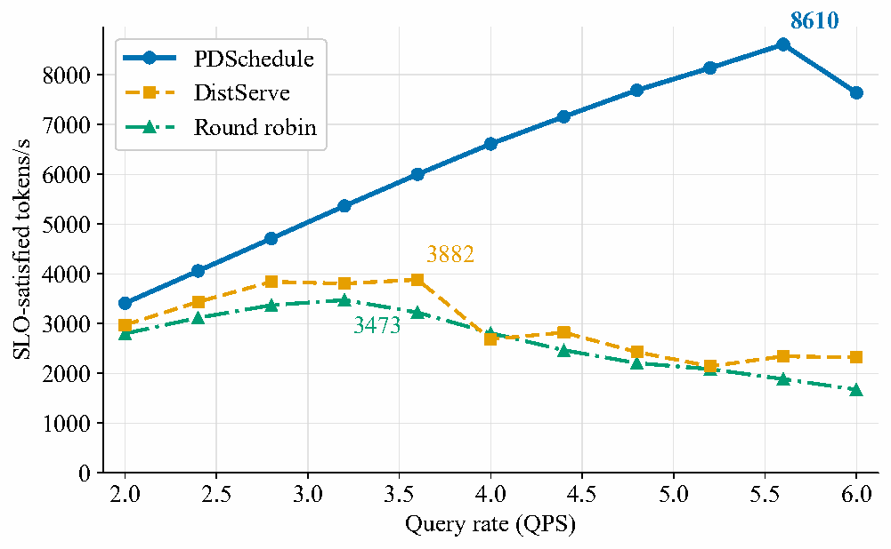
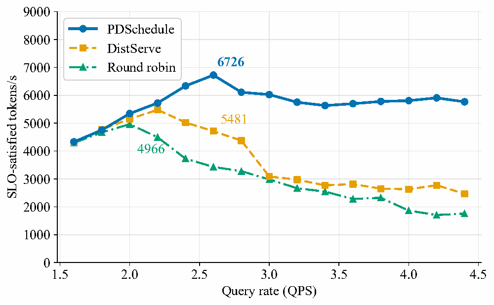
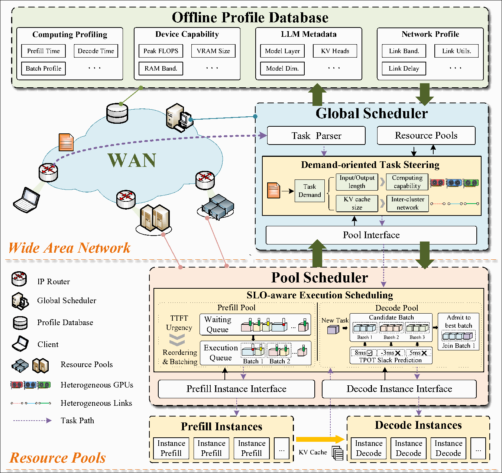

<p align="center">
  
</p>

<p align="center">
  <b>On-demand prefill-decode scheduling across wide-area networks</b>
</p>

<p align="center">
  <i>Built on vLLM. Designed for joint compute-network resource pairing and SLO-aware execution scheduling.</i>
</p>

<p align="center">
  
  <a href="LICENSE">
    
  </a>
  <a href="https://github.com/vllm-project/vllm">
    
  </a>
  <a href="https://github.com/ai-dynamo/nixl">
    
  </a>
  
  
  
</p>

<p align="center">
  <a href="#why-pdschedule">Why PDSchedule?</a> •
  <a href="#key-features">Features</a> •
  <a href="#architecture">Architecture</a> •
  <a href="#frontend-urls">Frontend URLs</a> •
  <a href="docs/environment.md">Environment</a> •
  <a href="#quick-start">Quick Start</a> •
  <a href="#api-usage">API</a> •
  <a href="#documentation">Docs</a>
</p>

> [!IMPORTANT]
> **Deployment scope:** the complete example uses real vLLM instances and NIXL over TCP/UCX. LMCache is also implemented as a shared-backend adapter, but is not required for this example. Each Gateway Pool uses one Connector; a PD request cannot bridge incompatible Connectors.

## PDSchedule

PDSchedule is a two-tier scheduling framework for prefill-decode (P-D) disaggregated LLM inference built on [vLLM](https://github.com/vllm-project/vllm). It targets serving environments where heterogeneous inference pools are connected by links with different bandwidths, delays, and runtime loads. Separating prefill from decode reduces cross-phase interference, but makes KV cache transfer part of the request's critical path. Choosing a faster GPU alone does not necessarily produce a faster response when the selected pool pair is connected by a slower or congested link.

PDSchedule addresses this problem by introducing joint compute-network task steering and SLO-aware execution scheduling. The Controller matches request demands with compatible prefill/decode pools using compute and network state. Within each selected pool, Gateway schedulers choose instances and organize work according to the phase's latency objective. A modular Connector layer carries the transfer context needed to connect the two phases.

## Why PDSchedule?

- 🌐 **Match compute and network together:** account for prefill work, decode demand, and the cost of transferring KV cache instead of selecting pools from compute load alone.
- ⏱️ **Schedule for request-level objectives:** distinguish TTFT urgency in prefill from TPOT pressure in decode, rather than treating every queued request as equally urgent.
- 🔀 **Use heterogeneous resources through two scheduling tiers:** separate WAN-scale pool selection from instance-level decisions, with dynamic registration and Connector-compatible pairing.

<p align="center">
  
  
</p>

<p align="center">
  <em>The paper reports up to 2.48× higher peak goodput than round robin on the evaluated traces. Goodput counts input and output tokens from requests that meet their specified SLOs.</em>
</p>

## Key Features

| Feature                                                         | Description                                                                                                                                                                        |
| --------------------------------------------------------------- | ---------------------------------------------------------------------------------------------------------------------------------------------------------------------------------- |
| ⚙️ **Joint** **Compute-network pool selection** | The global scheduler evaluates request demands, pool capabilities, runtime load, and inter-pool network state to select a compatible P/D pool pair.                                |
| 🧭 **Phase-specific Gateway scheduling**                  | Prefill policies include TTFT-aware scheduling, token-weighted JSQ, and round robin. Decode policies include TPOT-aware placement, lowest generation throughput, and round robin.  |
| 🔗 **Modular KV transfer protocols**                      | NIXL propagates request-scoped transfer context; LMCache checks shared-backend identity. Incompatible Pool pairs are filtered before a global policy runs.                         |
| 📊 **Runtime state and request observability**            | Instance proxies register dynamically and report resource state. The Controller request page and separate Gateway scheduling, timing, and resource logs expose the execution path. |

---

## Architecture

PDSchedule separates global task steering, pool-local scheduling, instance execution, and KV transfer coordination.

<p align="center">
  
</p>

- **Controller / Global Scheduler:** maintains resource snapshots, filters compatible Pool pairs, and performs global selection using demand-aware, least-load, or round-robin policies.
- **Prefill Gateway / Pool Scheduler:** selects a prefill instance and manages request execution using the configured prefill policy.
- **Decode Gateway / Pool Scheduler:** selects a decode instance using the configured generation-throughput or TPOT-aware policy.
- **Instance Proxy:** forwards requests to its local vLLM service, registers its Connector metadata, and reports resource measurements.
- **Connector:** validates endpoints and prepares the context required by NIXL or a shared LMCache backend. KV data does not pass through the Controller.
- **Profiling tools:** measure and fit TTFT/TPOT predictors. The repository provides predictor code; fitted artifacts are generated for each deployment rather than shipped with the project.

The figure presents the paper's two-tier design. In this repository, profile information is held in local files and runtime state; it is not a separately deployed database service. Gateway-level request organization and instance placement do not replace vLLM's internal continuous-batching scheduler.

### Default ports

The single-machine example uses the following ports. All components bind to loopback inside the same host-networked container.

| Component              | Service Plane | Control Plane / Auxiliary                           | UI                    |
| ---------------------- | ------------- | --------------------------------------------------- | --------------------- |
| Controller             | 5000          | Registration and resource updates share 5000        | `/requests` on 5000 |
| Prefill Gateway        | 8081          | Instance registration and Connector APIs share 8081 | -                     |
| Decode Gateway         | 8082          | Instance registration and Connector APIs share 8082 | -                     |
| Prefill Instance Proxy | 7001          | `/connectors` on 7001                             | -                     |
| Decode Instance Proxy  | 7003          | `/connectors` on 7003                             | -                     |
| Prefill vLLM           | 8001          | NIXL side channel 5557                              | -                     |
| Decode vLLM            | 8003          | NIXL side channel 5559                              | -                     |
| Optional Client UI     | 5050          | -                                                   | `/` on 5050         |

### Frontend URLs

| Component          | Frontend                            | Default URL                             | How to start                                                          | Status                                  |
| ------------------ | ----------------------------------- | --------------------------------------- | --------------------------------------------------------------------- | --------------------------------------- |
| Controller         | Request records and request details | `http://127.0.0.1:5000/requests`      | Start `entrypoints/controller.py` as described below.               | Available                               |
| Client             | Browser request interface           | `http://127.0.0.1:5050`               | `python3 examples/clientUI/client.py`                               | Available                               |
| Gateway / Instance | Resource and execution inspection   | Log files and `/connectors` endpoints | Start the corresponding service; see the observability section below. | Available without a dedicated dashboard |

The URLs assume loopback access on the deployment host. A browser on another machine needs an appropriate reachable listen address or SSH forwarding; `0.0.0.0` is a bind address, not a browser destination.

### System Workflow

1. The Client sends an OpenAI-compatible request to the Controller.
2. The Controller builds the request's service context and selects a compatible prefill/decode Pool pair.
3. The Prefill Gateway schedules the request on an active prefill instance.
4. The prefill vLLM executes prefill. Its request-scoped NIXL transfer parameters return through the Instance Proxy to the Prefill Gateway.
5. The Prefill Gateway forwards the request and Connector context to the Decode Gateway, which selects an active decode instance.
6. The decode vLLM retrieves KV cache through NIXL and generates the response; the response returns through the Gateway and Controller chain.
7. Instances and Gateways continue reporting load and resource state for later scheduling decisions.

### Scheduling policies

| Scheduling level | Policies                                                                |
| ---------------- | ----------------------------------------------------------------------- |
| Controller       | `demand_aware`, `least_load`, `round_robin`                       |
| Prefill Gateway  | `slo_aware_prefill`, `jsq`, `round_robin`                         |
| Decode Gateway   | `slo_aware_decode`, `lowest_generation_throughput`, `round_robin` |

With exactly one active P Pool and one active D Pool, the Controller selects the sole compatible pair directly. This does not bypass registration or instance-level scheduling. Multiple Pools restore the selected global policy automatically.

`jsq` balances unfinished input-token reservations and dispatches requests without forming a Gateway logical batch. `slo_aware_prefill` provides queued SLO-aware scheduling. Decode policies select instances; the underlying vLLM engine owns its active batches. Gateway CLI commands `show scheduler` and `switch scheduler -m <mode>` inspect or change local policies when CLI mode is enabled.

---

## Requirements

The NIXL deployment guide uses the following environment:

| Component          | Version / Configuration                                                             |
| ------------------ | ----------------------------------------------------------------------------------- |
| Platform           | NVIDIA CUDA on Linux x86_64                                                         |
| Python             | 3.12                                                                                |
| vLLM               | 0.13.0                                                                              |
| PyTorch            | 2.9.0, matching the vLLM dependency constraint                                      |
| Container CUDA     | 12.9.1 in the official vLLM 0.13.0 image build                                      |
| NIXL               | `nixl==0.7.1` and `nixl-cu12==0.7.1`                                            |
| KV transport       | UCX backend with `tcp,cuda_copy`                                                  |
| Example model      | Local DeepSeek-R1-Distill-Qwen-7B weights and tokenizer                             |
| Example GPU layout | Two GPUs, one TP=1 instance per phase; sufficient memory for the model and KV cache |

Use [`docs/environment.md`](docs/environment.md) for container creation, application dependency installation, model checks, and port checks. `requirements.txt` defines the application runtime; `requirements-dev.txt` adds public test dependencies, and `requirements-research.txt` adds optional research tools. PyTorch, vLLM, NIXL, and CUDA libraries belong to the serving environment and should not be replaced by an unrelated application dependency installation.

Redis and LMCache are not needed for this NIXL example. The paper's multi-pool evaluation uses a different setup.

---

## Quick Start

PDSchedule provides a complete NIXL-based deployment with real vLLM services. Each long-running process runs in a separate terminal; no local-only Shell launcher is required.

The host and container paths are:

```text
Host repository:      /llm-stack/PDSchedule
Container repository: /workspace/llm-stack/PDSchedule
Model directory:      /workspace/llm-stack/models/deepseek-ai/DeepSeek-R1-Distill-Qwen-7B
```

Prepare the host, model files, and dependencies using the [environment guide](docs/environment.md). Create the container once on the host:

```bash
docker pull vllm/vllm-openai:v0.13.0
docker run --name pdschedule-nixl --gpus all -it \
  --network host --ipc=host --shm-size=16g \
  -v /llm-stack:/workspace/llm-stack \
  -w /workspace/llm-stack/PDSchedule \
  --entrypoint /bin/bash \
  vllm/vllm-openai:v0.13.0
```

For each additional service terminal, enter the same container with:

```bash
docker exec -it pdschedule-nixl /bin/bash
```

<details>
<summary><b>Full single-machine run: P/D vLLM → Controller → P/D Gateway → P/D Instance Proxy → Client</b></summary>

The following commands assume the model and minimal application dependencies are already available inside the container. Ports and GPU assignments follow the table above. Adjust model paths and resource limits together when using another model.

#### 1. Terminal 1: start the prefill vLLM

```bash
cd /workspace/llm-stack/PDSchedule
export CUDA_VISIBLE_DEVICES=0
export PYTHONHASHSEED=0
export VLLM_USE_FLASHINFER_SAMPLER=0
export UCX_TLS=tcp,cuda_copy
export UCX_NET_DEVICES=all
export VLLM_NIXL_SIDE_CHANNEL_HOST=127.0.0.1
export VLLM_NIXL_SIDE_CHANNEL_PORT=5557
python3 -m vllm.entrypoints.openai.api_server \
  --model /workspace/llm-stack/models/deepseek-ai/DeepSeek-R1-Distill-Qwen-7B \
  --host 127.0.0.1 --port 8001 \
  --tensor-parallel-size 1 --dtype half \
  --gpu-memory-utilization 0.8 --max-model-len 4096 \
  --max-num-batched-tokens 4096 \
  --enforce-eager --attention-backend TRITON_ATTN \
  --no-enable-prefix-caching --disable-hybrid-kv-cache-manager \
  --kv-cache-metrics \
  --kv-transfer-config '{"kv_connector":"NixlConnector","kv_role":"kv_both","kv_load_failure_policy":"fail","kv_connector_extra_config":{"backends":["UCX"]}}'
```

#### 2. Terminal 2: start the decode vLLM

```bash
cd /workspace/llm-stack/PDSchedule
export CUDA_VISIBLE_DEVICES=1
export PYTHONHASHSEED=0
export VLLM_USE_FLASHINFER_SAMPLER=0
export UCX_TLS=tcp,cuda_copy
export UCX_NET_DEVICES=all
export VLLM_NIXL_SIDE_CHANNEL_HOST=127.0.0.1
export VLLM_NIXL_SIDE_CHANNEL_PORT=5559
python3 -m vllm.entrypoints.openai.api_server \
  --model /workspace/llm-stack/models/deepseek-ai/DeepSeek-R1-Distill-Qwen-7B \
  --host 127.0.0.1 --port 8003 \
  --tensor-parallel-size 1 --dtype half \
  --gpu-memory-utilization 0.8 --max-model-len 4096 \
  --max-num-batched-tokens 4096 \
  --enforce-eager --attention-backend TRITON_ATTN \
  --no-enable-prefix-caching --disable-hybrid-kv-cache-manager \
  --kv-cache-metrics \
  --kv-transfer-config '{"kv_connector":"NixlConnector","kv_role":"kv_both","kv_load_failure_policy":"fail","kv_connector_extra_config":{"backends":["UCX"]}}'
```

The `kv_both` engine capability is distinct from the P/D role of each PDSchedule Instance Proxy. The request context determines which phase each instance performs. This example uses identical model, dtype, TP, and attention settings on both sides. `kv_load_failure_policy=fail` prevents silent recomputation after a KV load failure.

#### 3. Wait for both model endpoints

From a separate check terminal:

```bash
python3 - <<'PY'
import json
import urllib.request
opener = urllib.request.build_opener(urllib.request.ProxyHandler({}))
model = "/workspace/llm-stack/models/deepseek-ai/DeepSeek-R1-Distill-Qwen-7B"
for port in (8001, 8003):
    with opener.open(f"http://127.0.0.1:{port}/v1/models", timeout=10) as response:
        body = json.load(response)
    assert model in [item["id"] for item in body["data"]], body
    print(f"vLLM {port}: ready")
PY
```

Expected output:

```text
vLLM 8001: ready
vLLM 8003: ready
```

Wait for model loading to finish before proceeding; a fixed startup delay is not a readiness check.

#### 4. Terminal 3: start the Controller

```bash
cd /workspace/llm-stack/PDSchedule
export CUDA_VISIBLE_DEVICES=""
python3 entrypoints/controller.py --host 127.0.0.1 --port 5000
```

Keep this terminal open at the `scheduler-cli>` prompt. The Controller requires an interactive terminal and does not implement `--no-cli`.

#### 5. Terminal 4: start the Prefill Gateway

```bash
cd /workspace/llm-stack/PDSchedule
export CUDA_VISIBLE_DEVICES=""
python3 entrypoints/gatewayP.py \
  --host 127.0.0.1 --port 8081 \
  --controller 127.0.0.1:5000 \
  --prefill 127.0.0.1:7001 --decode 127.0.0.1:8082 \
  --prefill-scheduler-strategy jsq \
  --connector-name nixl --connector-version 1 --connector-metadata '{}' \
  --no-ttft-warmup --no-cli
```

#### 6. Terminal 5: start the Decode Gateway

```bash
cd /workspace/llm-stack/PDSchedule
export CUDA_VISIBLE_DEVICES=""
python3 entrypoints/gatewayD.py \
  --host 127.0.0.1 --port 8082 \
  --controller 127.0.0.1:5000 --decode 127.0.0.1:7003 \
  --decode-scheduler-strategy round_robin \
  --connector-name nixl --connector-version 1 --connector-metadata '{}' \
  --no-tpot-warmup --no-cli
```

The baseline policies avoid making predictor calibration a prerequisite for the first request. Gateway member addresses do not replace dynamic Instance registration.

#### 7. Terminal 6: start the Prefill Instance Proxy

```bash
cd /workspace/llm-stack/PDSchedule
unset CUDA_VISIBLE_DEVICES
python3 entrypoints/instanceP.py \
  --host 127.0.0.1 --port 7001 --vllm_port 8001 \
  --gateway 127.0.0.1:8081 \
  --connector-name nixl --connector-version 1 \
  --connector-metadata '{"side_channel_host":"127.0.0.1","side_channel_port":5557,"tp_size":1}' \
  --gpu-indices 0
```

#### 8. Terminal 7: start the Decode Instance Proxy

```bash
cd /workspace/llm-stack/PDSchedule
unset CUDA_VISIBLE_DEVICES
python3 entrypoints/instanceD.py \
  --host 127.0.0.1 --port 7003 --vllm_port 8003 \
  --gateway 127.0.0.1:8082 \
  --connector-name nixl --connector-version 1 \
  --connector-metadata '{"side_channel_host":"127.0.0.1","side_channel_port":5559,"tp_size":1}' \
  --gpu-indices 1
```

`--gpu-indices` identifies NVML-visible physical GPUs for resource reporting. It is not the local CUDA index after vLLM applies `CUDA_VISIBLE_DEVICES`. Instance Proxy and its vLLM service run on the same host; `--host` is also used to reach that vLLM port.

#### 9. Inspect registration and Connector identity

From the check terminal:

```bash
python3 - <<'PY'
import json
import urllib.request
opener = urllib.request.build_opener(urllib.request.ProxyHandler({}))
for port in (8081, 8082, 7001, 7003):
    with opener.open(f"http://127.0.0.1:{port}/connectors", timeout=10) as response:
        body = json.load(response)
    assert body["connector"]["name"] == "nixl", body
    assert body["connector"]["version"] == "1", body
    print(f"{port}: connector=nixl version=1 mode={body['mode']}")
PY
```

Expected output contains four lines with `connector=nixl version=1 mode=request_scoped`.

At the Controller's `scheduler-cli>` prompt, enter:

```text
show pool_id
show scheduler
```

The Pool table should contain `127.0.0.1:8081` and `127.0.0.1:8082`; IDs are assigned at runtime. The routing status should contain `single_gateway_direct`, not `resource_wait`. Instance startup must also complete without recurring registration errors.

#### 10. Send a request through the Controller

Execute this Python request inside the same container:

```bash
python3 - <<'PY'
import json
import urllib.error
import urllib.request
payload = {
    "model": "/workspace/llm-stack/models/deepseek-ai/DeepSeek-R1-Distill-Qwen-7B",
    "messages": [{"role": "user", "content": "Explain prefill and decode in two sentences."}],
    "max_tokens": 128,
    "temperature": 0.7,
    "stream": False,
}
request = urllib.request.Request(
    "http://127.0.0.1:5000/v1/chat/completions",
    data=json.dumps(payload).encode("utf-8"),
    headers={"Content-Type": "application/json"},
    method="POST",
)
opener = urllib.request.build_opener(urllib.request.ProxyHandler({}))
try:
    with opener.open(request, timeout=300) as response:
        status = response.status
        body = json.load(response)
except urllib.error.HTTPError as exc:
    raise SystemExit(f"HTTP {exc.code}: {exc.read().decode('utf-8', errors='replace')}")
assert status == 200 and body.get("choices") and not body.get("error"), body
assert body["choices"][0].get("finish_reason") != "error", body
print("HTTP", status)
print(json.dumps(body, ensure_ascii=False, indent=2))
PY
```

Expected response shape; text, IDs, token counts, and finish reasons vary:

```json
{
  "id": "chatcmpl-<request-id>",
  "object": "chat.completion",
  "model": "/workspace/llm-stack/models/deepseek-ai/DeepSeek-R1-Distill-Qwen-7B",
  "choices": [
    {"index": 0, "message": {"role": "assistant", "content": "<model-generated text>"}, "finish_reason": "stop"}
  ]
}
```

The current service-context mapping uses the Client source address. Keep this example on loopback: requests arriving from `10.0.*` or `192.168.*` may select a non-PD path. A successful text response alone is not evidence that a request used PD.

#### 11. Confirm the PD path and actual KV transfer

Correlate these log fragments for the same request:

```text
PD分离:  True
[Controller-Connector] ... connector=nixl session_id=nixl-...
[Prefill Schedule] Selected instance: 127.0.0.1:7001
[Decode-Connector] validation succeeded request_id=... connector=nixl prefill_instance=127.0.0.1:7001 decode_instance=127.0.0.1:7003 session_id=...
```

Read the following metrics before and after a request, allowing for the vLLM statistics refresh interval:

```bash
python3 - <<'PY'
import urllib.request
opener = urllib.request.build_opener(urllib.request.ProxyHandler({}))
prefixes = (
    "vllm:nixl_bytes_transferred_sum",
    "vllm:nixl_bytes_transferred_count",
    "vllm:nixl_num_failed_transfers_total",
)
with opener.open("http://127.0.0.1:8003/metrics", timeout=10) as response:
    text = response.read().decode("utf-8")
for line in text.splitlines():
    if line.startswith(prefixes):
        print(line)
PY
```

The transferred-byte sum and transfer count should increase, without an increase in failed transfers. Connector identity and the Decode validation log establish compatibility; they do not by themselves establish data transfer. See the [deployment guide](docs/quickstart.md) for troubleshooting and shutdown.

</details>

### Optional: Browser Client

After the services are ready, start the existing browser Client from another terminal:

```bash
cd /workspace/llm-stack/PDSchedule
python3 examples/clientUI/client.py
```

Open `http://127.0.0.1:5050` and use the Controller's `http://127.0.0.1:5000/v1/chat/completions` endpoint rather than a vLLM endpoint.

---

## API Usage

### Chat Completion

```bash
curl http://127.0.0.1:5000/v1/chat/completions \
  -H "Content-Type: application/json" \
  -d '{
    "model": "/workspace/llm-stack/models/deepseek-ai/DeepSeek-R1-Distill-Qwen-7B",
    "messages": [{"role": "user", "content": "Explain prefill-decode disaggregation."}],
    "max_tokens": 128,
    "temperature": 0.7,
    "stream": false
  }'
```

### Completion

```bash
curl http://127.0.0.1:5000/v1/completions \
  -H "Content-Type: application/json" \
  -d '{
    "model": "/workspace/llm-stack/models/deepseek-ai/DeepSeek-R1-Distill-Qwen-7B",
    "prompt": "Prefill-decode disaggregation separates",
    "max_tokens": 128,
    "temperature": 0.7,
    "stream": false
  }'
```

### Request Options

| Option                      | Required    | Description                                                                                                                 |
| --------------------------- | ----------- | --------------------------------------------------------------------------------------------------------------------------- |
| `model`                   | Yes         | The model identifier accepted by the selected vLLM services; this example uses the shared local model path.                 |
| `messages` / `prompt`   | Yes         | Chat messages or completion input.                                                                                          |
| `max_tokens`              | No          | Requested output-token budget.                                                                                              |
| `stream`                  | No          | Whether to request streaming output; the examples above use non-streaming JSON.                                             |
| `temperature`, `top_p`  | No          | Sampling controls parsed by the request schema; the examples use a positive temperature.                                    |
| `Enable_Affinity`         | No          | Enable affinity lookup when `user_id` and `session_id` are also supplied. The single-Pool route still takes precedence. |
| `user_id`, `session_id` | Conditional | Session identity used by the affinity path.                                                                                 |

The Controller constructs internal scheduling and Connector context. Do not manually insert NIXL block IDs into a normal Client request. Current SLO values and PD enablement come from the service-context mapping, not arbitrary extra request fields.

## Current Status

PDSchedule is under active development. The repository currently provides:

- Two-tier Controller/Gateway scheduling with three policies at each scheduling level.
- Dynamic Pool and Instance registration, resource reporting, and a single-P/D-Pool direct route.
- Connector-aware candidate filtering, NIXL request-scoped transfer, and LMCache shared-backend identity checks.
- OpenAI-compatible chat/completion forwarding, an optional browser Client, and a Controller request page.
- Separate Gateway scheduling, timing, and resource logs.
- TTFT/TPOT measurement, fitting, and prediction code without deployment-specific fitted models.

Paper plots are included for context. The complete paper workload harness and calibrated experiment artifacts are not distributed as a reproducibility bundle in this repository.

From a Python 3.12 virtual environment, install the public test dependencies and run the complete CPU regression suite:

```bash
python -m pip install -r requirements-dev.txt
python -m pip check
python -m pytest -q
```

See [`test/README.md`](test/README.md) for environment creation, per-module checks, loopback networking, and the distinction between CPU tests and real KV-transfer validation. The default collection excludes the unpublished local synchronization test.

### Roadmap

- [X] Modular global and Pool-local scheduling policies
- [X] Dynamic registration and live resource-state updates
- [X] Connector-compatible P/D pairing
- [X] NIXL and LMCache adapters
- [X] Complete Python-based NIXL deployment instructions
- [X] Controller request page and Gateway execution/resource logs
- [X] Source-only TTFT/TPOT profiling and prediction tools
- [ ] More multi-Pool and multi-machine deployment examples
- [ ] Packaged installation and source-independent resource loading
- [ ] Public workload replay tools and a reproducible paper-evaluation bundle
- [ ] Tagged release and public paper/citation entry

---

## Documentation

| Document                                                                        | Description                                                                                           |
| ------------------------------------------------------------------------------- | ----------------------------------------------------------------------------------------------------- |
| [`docs/environment.md`](docs/environment.md)                                   | Container setup, version constraints, minimal dependencies, GPU/model checks, and port preparation.   |
| [`docs/quickstart.md`](docs/quickstart.md)                                     | Complete NIXL 1P/1D topology, all seven service commands, requests, transfer checks, and shutdown.    |
| [`doc/项目代码结构说明.md`](doc/项目代码结构说明.md)                           | Repository structure, runtime flow, and extension points for schedulers and Connectors.               |
| [`examples/nixl_tcp_fallback/README.md`](examples/nixl_tcp_fallback/README.md) | TCP transport guidance and the distinction between upstream Connector checks and the PDSchedule path. |
| [`profile/README.md`](profile/README.md)                                       | Profiling tools and deployment-local predictor artifacts.                                             |
| [`profile/TTFT_predictor/README.md`](profile/TTFT_predictor/README.md)         | TTFT measurement, fitting, prediction, and local calibration.                                         |
| [`profile/TPOT_predictor/README.md`](profile/TPOT_predictor/README.md)         | TPOT measurement and prediction interfaces.                                                           |
| [`profile/controller/README.md`](profile/controller/README.md)                 | Optional Controller calibration files and missing-profile behavior.                                   |
| [`LICENSE`](LICENSE)                                                           | Apache License 2.0. Author information remains a placeholder.                                         |
| [`test/README.md`](test/README.md) | Public CPU regression setup, collection scope, focused commands, and external-service boundaries. |
