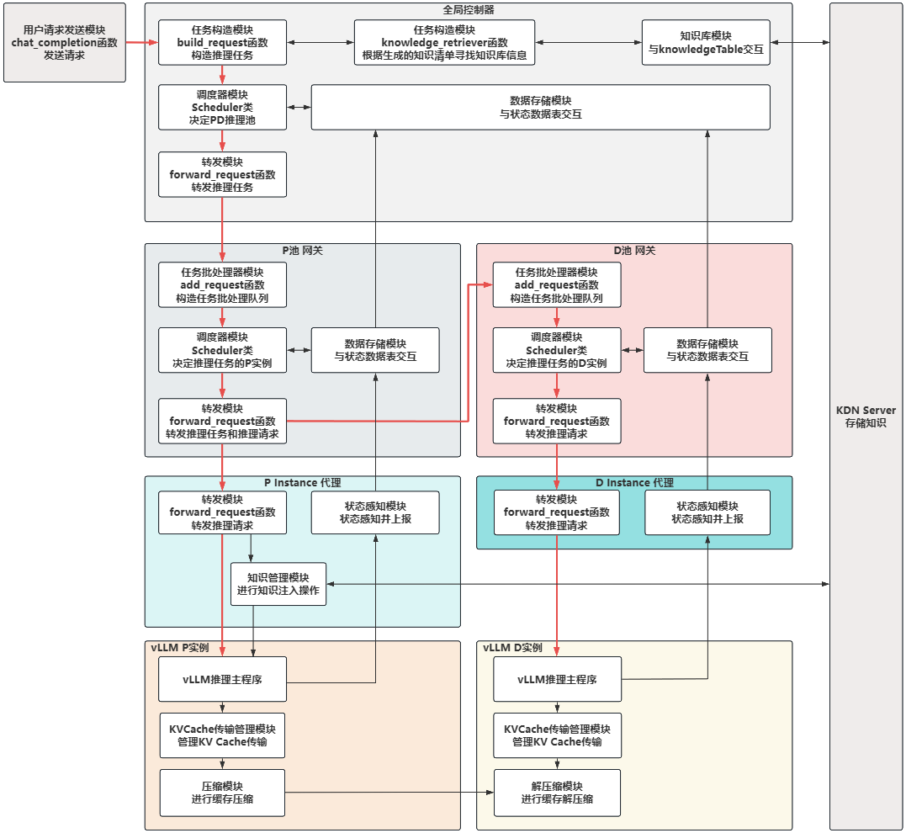

# 简介

**FlexPD** 是一种基于**vLLM**、**LMCache**和**Mooncake**开发的LLM推理任务调度平台，专注于实现 Prefill 阶段与 Decode 阶段的算力分离与灵活配对。在大语言模型推理过程中，Prefill 阶段需要高并行计算能力且耗时较短，而 Decode 阶段则需持续占用计算资源但算力需求相对较低；传统静态调度方式常导致两阶段资源争抢或利用率不足，难以有效利用分布式的零散算力。为此，FlexPD 设计了一套轻量级调度算法，能够实时感知可用的 Prefill 与 Decode 算力资源，并根据任务队列长度、模型结构、输入输出长度等特征，动态将两阶段计算任务匹配至合适的算力节点。该系统通过解耦并灵活配对 Prefill 与 Decode 算力，显著提升异构算力资源的整体利用率，支持在分布式环境下实现更低延迟、更高吞吐的大语言模型推理服务。

# 架构

项目结构图如下所示，点击 [这里](./doc/项目代码结构说明.md) 查看关于项目代码结构的具体说明。



- 由用户请求发送模块发起推理任务，发送prompt给全局控制器做全局资源池选择。
- 全局控制器收到请求后解析请求和标识信息并构造推理任务，通过embed模型分析prompt并与知识库中条目比对，通过调度策略选择合适的Prefill与Decode推理算力池，并转发推理任务请求。
- 算力池网关接收任务请求后通过调度策略选择池内的推理实例并转发请求。
- 实例代理接收请求并转发给vLLM实例，并实时感知实例状态。
- vLLM实例完成推理任务，并在KV Cache传输时提供压缩功能。

# 环境说明

项目当前版本使用Docker环境，点击 [这里](./doc/docker/vLLM-Docker环境安装笔记.md) 参考查看环境安装相关笔记：

- Ubuntu 22.04
- vLLM 0.13.0
- LMCache 3.11
- Pytorch 2.9.1
- Mooncake 0.3.8 (可选)

此外还需要一个Redis容器环境，点击 [这里](./doc/docker/Redis安装笔记.md) 查看环境安装相关记录：

- Redis 7

# 快速开始

此项目在 vLLM PD分离方案的基础上进行推理池和推理实例的选择与动态配对，点击 [这里](./doc/PD分离案例.md) 查看PD分离基础案例。

此项目的旧版本使用基于MooncakeP2PConnector的PD分离方案，点击 [这里](./doc/Mooncake版本.md) 查看旧版本快速开始说明。

当前版本使用基于LMCacheConnectorV1的PD分离方案，以下指令为在 **实验室8卡5090机器** 上的启动指令：

### 1 启动环境

启动 vLLM 容器环境

```bash
# 新建容器
sudo docker run --gpus all --shm-size=16g -it --network host -v /llm-stack:/workspace/llm-stack --name test cacheroute:vllm0.13-lmcache3.11-pytorch2.9.1

sudo docker run --shm-size=16g -it --network host -v /llm-stack:/workspace/llm-stack --name test-proxyp cacheroute:vllm0.13-lmcache3.11-pytorch2.9.1

sudo docker run --shm-size=16g -it --network host -v /llm-stack:/workspace/llm-stack --name test-proxyd cacheroute:vllm0.13-lmcache3.11-pytorch2.9.1

# 启动容器
sudo docker start test
# 打开容器
sudo docker exec -it test /bin/bash
# 停止容器
sudo docker stop test
# 关闭容器
sudo docker rm test
```

启动 Redis 容器环境

```bash
# 新建容器
sudo docker run -d --name flexpd-redis -p 6378:6379 redis:7 redis-server --save "" --appendonly no --maxmemory 200gb --maxmemory-policy allkeys-lru
# 打开容器
sudo docker exec -it flexpd-redis /bin/bash
# 清除 Redis 缓存
redis-cli flushall
# 查看 Redis 缓存大小
redis-cli info memory | grep used_memory_human
```

### 2 启动系统

`config/ADDRESS_CONFIG.py` 只保存公共默认端口，不保存机器拓扑。各模块的 IP、上级服务地址、实例列表和 NIXL 参数通过启动参数或 `FLEXPD_*` / `VLLM_NIXL_*` 环境变量提供。实例启动后会向所属网关动态注册；部署新机器时无需复制或修改 Python 地址配置。

主要启动参数包括 `--host`、`--port`、`--controller`、`--gateway`、`--prefill`、`--decode`、`--side-channel-host`、`--side-channel-port` 和 `--tp-size`。可参考 `run_166.sh`、`run_167.sh`、`run_169.sh`、`run_170.sh`。

Prefill 网关可通过 `--prefill-scheduler-strategy` 选择 `least_load`、`round_robin` 或 `pso_new`；Decode 网关可通过 `--decode-scheduler-strategy` 选择 `round_robin`、`lowest_generate_throughput` 或 `slo_tpot_admission`。网关默认启动交互式 CLI，运行期间可使用 `show scheduler` 查看策略，使用 `switch scheduler -m <mode>` 在线切换策略。systemd、nohup 或无 TTY 容器部署时请增加 `--no-cli`。

交互式网关 CLI 支持上下方向键查看历史，并支持 Tab 自动补全命令和当前网关可用的调度策略。

在 Ubuntu 部署机上可使用根目录的 `sync.sh` 同步代码并修复 Shell 脚本执行权限：

```bash
# 默认同步 origin/p2p-flexpd
./sync.sh

# 覆盖远端名和分支名
./sync.sh origin p2p-flexpd
```

脚本会先把 staged、unstaged 和未跟踪的本地改动保存到临时 stash，再获取远端代码。只有本地独有路径的改动会以普通未提交工作区改动恢复；同一路径只要本地和远端都发生修改，即使 Git 能自动合并，当前工作区也采用远端完整版本，原本地内容保留在脚本输出的 stash 中供人工检查。此时脚本返回状态码 `2`，可使用 `git stash show -p <stash-ref>` 查看备份。脚本不会提交恢复后的本地改动，也不会自动推送代码。

```bash
# 进入项目所在目录
cd /workspace/llm-stack/workspace_LLL/FlexPD
# 启动脚本 (脚本需777)
./run.sh
```

### 3 注册知识（可选）

启动多窗口脚本后，在 “9.KDN-CLI” 窗口输入指令进行知识注入

注册文本，选择包含知识的文本文件路径

```bash
# 关于LLM的知识
:file /workspace/llm-stack/workspace_LLL/FlexPD/kdn_server/prompts/req1.txt
```

注册缓存，选择包含知识的文本文件路径、计算缓存的vLLM接口、计算缓存的模型型号

```bash
# 关于LMCache的知识
:buildkv_file /workspace/llm-stack/workspace_LLL/FlexPD/kdn_server/prompts/req2.txt --api-url http://172.18.0.169:8001/v1/chat/completions --model /workspace/llm-stack/models/deepseek-ai/DeepSeek-R1-Distill-Qwen-1.5B
```

### 4 网页交互

系统启动后，可以通过访问 "3.Controller" 提供的IP地址和端口来查看系统管理页面

除此之外，还可以通过用户侧网页脚本发送请求，试验全流程

```bash
# 进入目录
cd /workspace/llm-stack/workspace_LLL/FlexPD/examples/clientUI
# 启动脚本，在脚本提供的网页中发送请求
python3 client.py
```

# 常见问题

```bash
# 使用脚本 多窗口同时启动 时遇到这个问题
# Error constructing proxy for org.gnome.Terminal:/org/gnome/Terminal/Factory0: Failed to execute child process “dbus-launch” (No such file or directory)
sudo apt install dbus-x11
```

