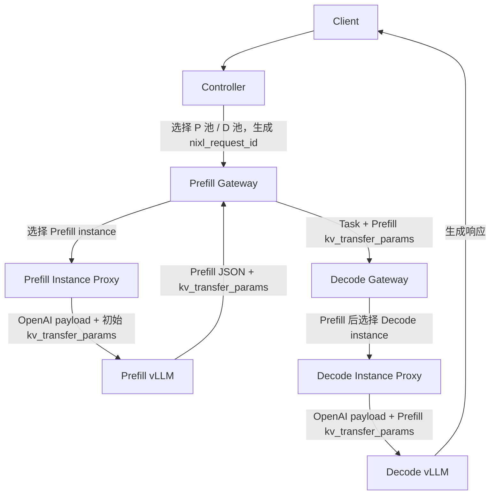

# P2P_FlexPD NIXL 动态跨池 PD 配对改造总结（历史）

> 本文记录旧 NIXL 专用请求结构，不代表当前 API。当前实现使用
> `connectors/` 协议层以及通用 `connector_session_id` /
> `connector_context`；旧 NIXL Task 字段和 `/pd/pair` 链路已经删除。

`P2P_FlexPD` 当前主链路已经从基于 `P2pNcclConnector` 的地址编码式 P2P KV 传输，切换为基于 vLLM `NixlConnector` 的 `kv_transfer_params` 传递式 PD 分离链路。

本次改造不再在请求开始前同时确定 Prefill/Decode 实例，而是采用更适合 NIXL 的两段调度：



## 核心变化

### Task 字段

`P2P_FlexPD/core/schemas/request.py` 中 `Task` 使用 NIXL 字段描述 PD 交接：

```python
pd_connector: str = "NixlConnector"
nixl_request_id: str = ""
nixl_kv_transfer_params: Dict[str, Any] = field(default_factory=dict)
prefill_tp_size: int = 0
decode_tp_size: int = 0
prefill_side_channel_addr: str = ""
decode_side_channel_addr: str = ""
decode_selection_stage: str = "after_prefill"
```

旧的 P2P 地址字段与 `p2p_request_id` 已从主 schema 中移除。

### 动态 NIXL metadata

实例启动时向所属网关的 `/instance/register` 注册以下 NIXL metadata：

- `connector`
- `role`
- `side_channel_host`
- `side_channel_port`
- `tp_size`

网关将元数据保存在运行时实例表中。心跳只更新负载，注销负责将实例移出在线候选集合。Prefill 网关把已选实例的 TP 和 side-channel 信息随请求传给 Decode 网关，因此各网关不再依赖 `ADDRESS_CONFIG.py` 中的全局静态拓扑。

### Controller

`P2P_FlexPD/core/handlers/controller/proxy.py` 只负责：

- 全局调度选择 Prefill 池和 Decode 池。
- 校验 P/D gateway 地址存在。
- 生成 `Task.nixl_request_id`。
- 设置 `Task.pd_connector = "NixlConnector"`。
- 将请求转发给 Prefill Gateway。

Controller 不再提前选择 Decode 实例。

### GatewayP

`P2P_FlexPD/core/handlers/gateway/prefill/proxy.py` 负责 Prefill 阶段：

- 复用现有 Prefill 实例选择逻辑选择 P instance。
- 绑定 Prefill NIXL metadata。
- 构造 Prefill payload：
  - `stream = False`
  - `max_tokens = 1`
  - 初始 `kv_transfer_params`
- 非流式调用 Prefill vLLM。
- 从 Prefill 响应中解析真实 `kv_transfer_params`。
- 将 `Task.nixl_kv_transfer_params` 转发给 Decode Gateway。

GatewayP 不选择 Decode 实例。

### GatewayD

`P2P_FlexPD/core/handlers/gateway/decode/proxy.py` 在 Prefill 完成后才选择 Decode 实例：

- 复用当前 Decode scheduler / admission 逻辑。
- 绑定 Decode NIXL metadata。
- 校验 P/D 两端均为 `NixlConnector`，且 role 为 prefill/decode。
- 将 Prefill 返回的 `kv_transfer_params` 注入 Decode OpenAI payload。
- 将请求转发给 Decode vLLM。

如果 PD 请求缺少 `kv_transfer_params`，GatewayD 直接返回错误，避免 Decode 空跑或卡住。

### NIXL 工具

`P2P_FlexPD/utils/nixl_request.py` 负责：

- 生成 `nixl_request_id`。
- 生成初始 `kv_transfer_params`。
- 构造 NIXL Prefill payload。
- 解析 Prefill 响应中的 `kv_transfer_params`。
- 构造 NIXL Decode payload。
- 生成 `X-Request-Id` 透传 header。

`X-Request-Id` 在 NIXL 下只作为 P/D 两端请求关联 id，不再编码 Prefill/Decode 地址。

### 启动脚本

以下脚本已经切换到 `NixlConnector` 和 TCP fallback：

- `P2P_FlexPD/run_170.sh`
- `P2P_FlexPD/run_169.sh`
- `P2P_FlexPD/run_167.sh`
- `P2P_FlexPD/run_166.sh`

统一配置：

```bash
export UCX_TLS=tcp,cuda_copy
export VLLM_NIXL_SIDE_CHANNEL_HOST=<真实机器 IP>
export VLLM_NIXL_SIDE_CHANNEL_PORT=<实例唯一端口>
```

Prefill vLLM 使用：

```json
{"kv_connector":"NixlConnector","kv_role":"kv_producer","kv_load_failure_policy":"fail","kv_connector_extra_config":{"backends":["UCX"],"kv_lease_duration":120}}
```

Decode vLLM 使用：

```json
{"kv_connector":"NixlConnector","kv_role":"kv_consumer","kv_load_failure_policy":"fail","kv_connector_extra_config":{"backends":["UCX"],"kv_lease_duration":120}}
```

`--ttft-warmup` 已从相关 Prefill Gateway 启动命令中移除，避免 warmup 直连 Prefill vLLM 且缺少 `kv_transfer_params`。

## 当前边界

- 首版只支持单轮 P -> D KV transfer。
- 不支持 bidirectional / multi-turn KV 复用。
- 不保留运行时 P2P/NIXL 双分支。
- 不引入 LMCache。
- 当前 TCP fallback 已可用于功能验证；生产性能仍需结合 RDMA/RoCE/IB 另行评估。
