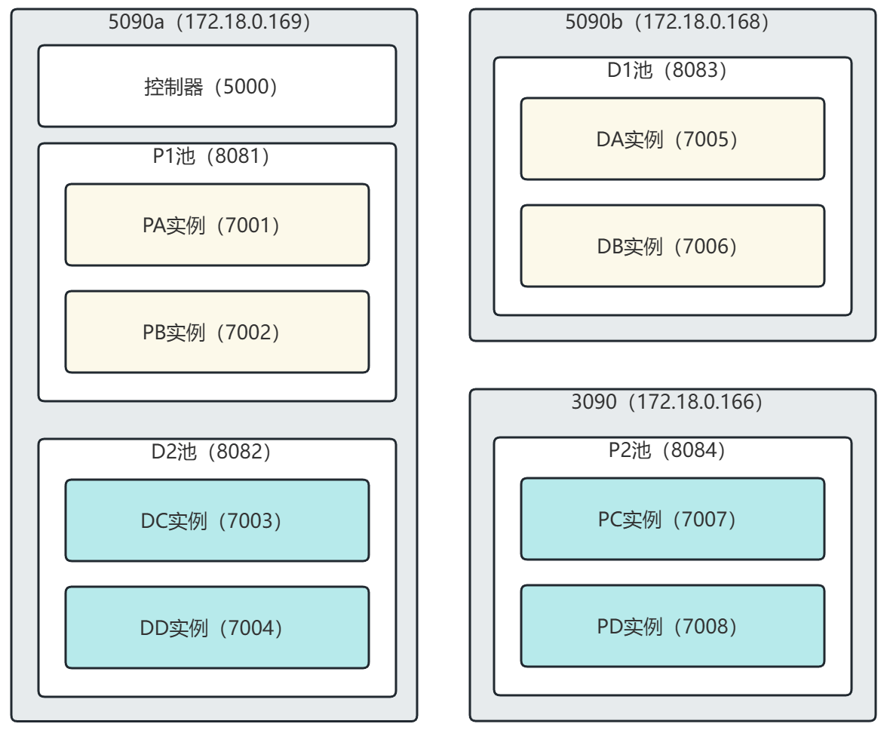

# 测试案例




```bash
# 在config.ADDRESS_CONFIG里修改IP地址等

# 在5090*8机器上创建docker容器
sudo docker run --gpus all --shm-size=16g -it --network host -v /home/zkgy/vLLM/workspace:/workspace/workspace --name test vllm-5090:latest

# 在5090*7机器上创建docker容器
sudo docker run --gpus all --shm-size=16g -it --network host -v /llm-stack:/workspace/workspace --name test vllm-5090:latest

# 在3090机器上创建docker容器
sudo docker run --gpus all -it --network host -v /home/jtdx/vLLM/workspace:/workspace/workspace --name test vllm-cuda128:latest

# 启动容器
sudo docker exec -it test /bin/bash

# 修改源码
cp /workspace/workspace/FlexPD/instance/vLLM/mooncake_v0/mooncake_pipe.py /workspace/vllm/vllm/distributed/kv_transfer/kv_pipe/mooncake_pipe.py 

cp /workspace/workspace/FlexPD/instance/vLLM/mooncake_v0/simple_buffer.py /workspace/vllm/vllm/distributed/kv_transfer/kv_lookup_buffer/simple_buffer.py

# 在docker容器外(确保容器处于start状态)，运行启动脚本
# 在8卡5090上
cd /workspace/workspace/FlexPD/examples/mooncake_v0/multi
sudo sh ./5090a.sh

# 在7卡5090上
cd /workspace/workspace/FlexPD/examples/mooncake_v0/multi
sudo sh ./5090b.sh

# 在3090-166上
cd /workspace/workspace/FlexPD/examples/mooncake_v0/multi
sudo sh ./3090.sh

# 启动用户脚本
cd /workspace/workspace/FlexPD/examples/clientUI
python3 client.py

# 在controller中输入指令查看ID
show pool_id
# 在controller中输入指令配对实例
pair pd -p 1 -d 202
pair pd -p 1 -d 202 --force=true
pair pd -p 202 -d 201
pair pd -p 202 -d 201 --force=true

# 输入指令，发送请求
http://127.0.0.1:5000/v1/chat/completions -H "Content-Type: application/json" -d '{"model": "/workspace/workspace/models/deepseek-ai/DeepSeek-R1-Distill-Qwen-7B","messages": [{"role": "user", "content": "What is DeepSeek"}],"max_tokens": 64,"stream":"True"}' 

http://127.0.0.1:5000/v1/chat/completions -H "Content-Type: application/json" -d '{"model": "/workspace/workspace/models/deepseek-ai/DeepSeek-R1-Distill-Qwen-7B","messages": [{"role": "user", "content": "What is DeepSeek"}],"max_tokens": 64,"stream":"False"}'
```

